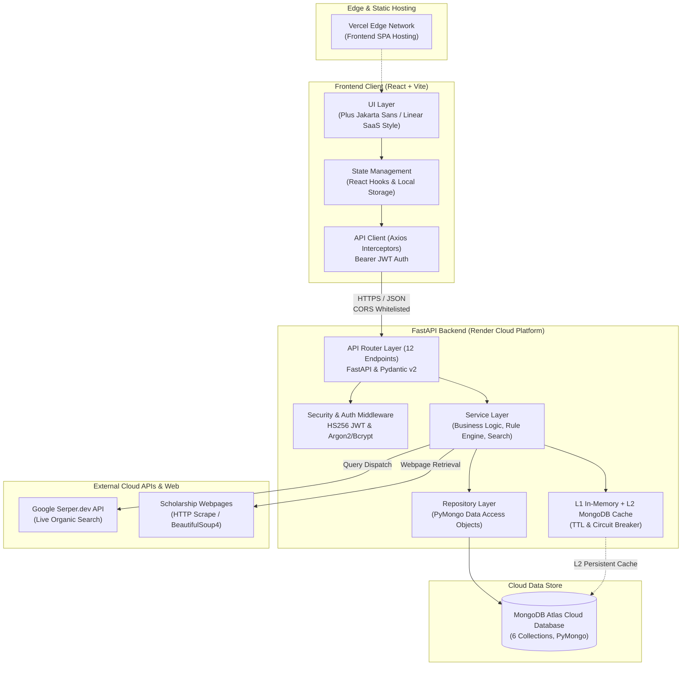
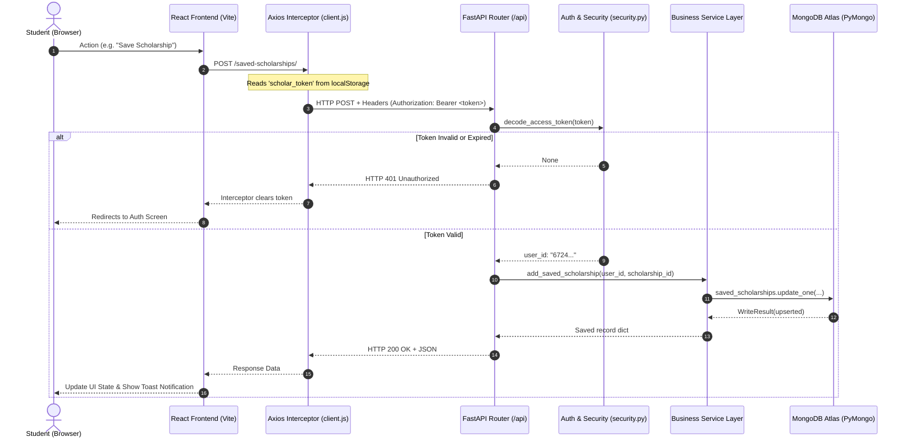
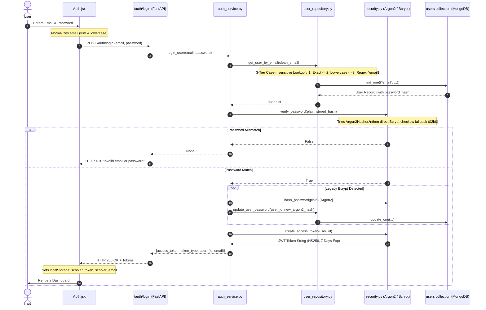
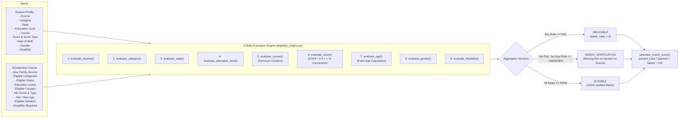
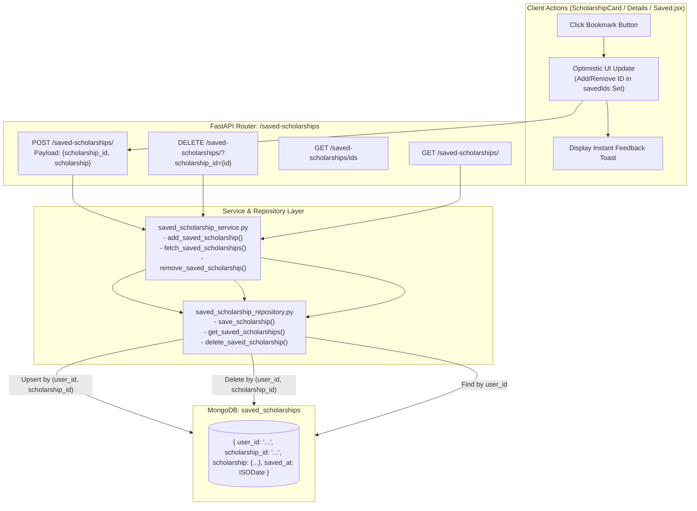
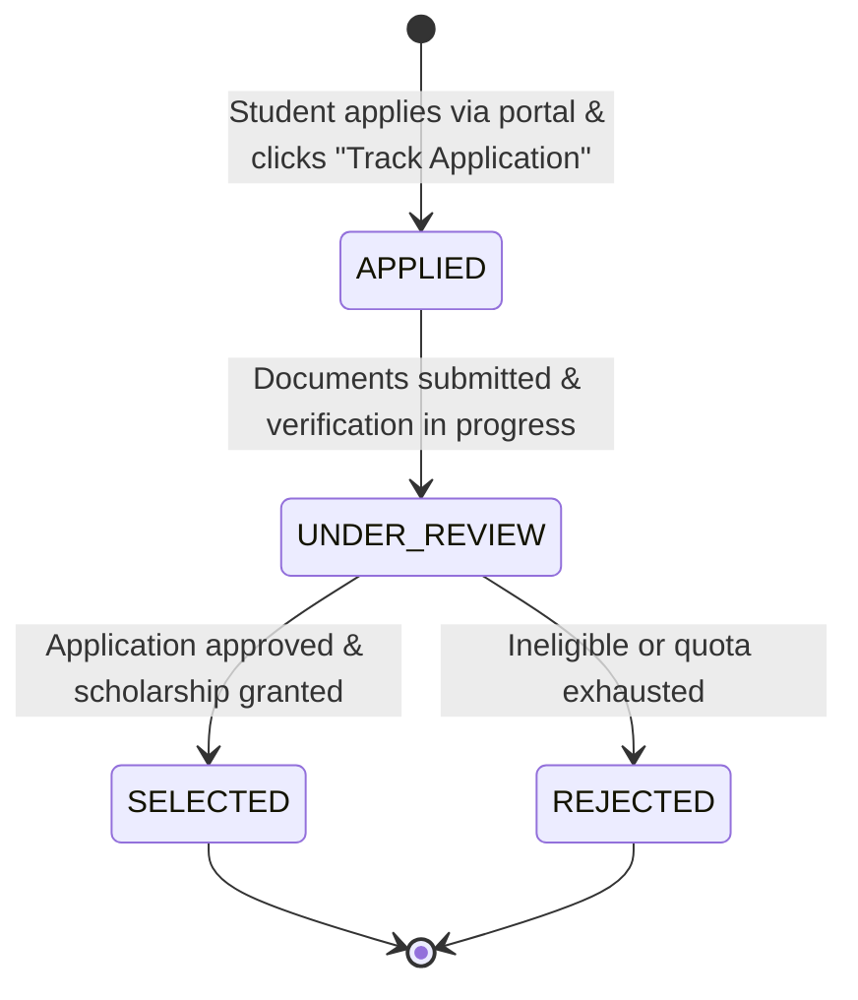
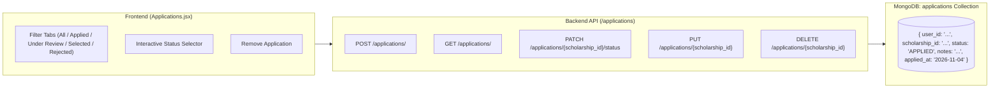

# Scholar AI — System Architecture & Workflow Specifications

This document outlines the software architecture, data flow pipelines, component responsibilities, and process workflows for **Scholar AI**, an AI-assisted scholarship discovery and eligibility matching platform for Indian college students.

---

## 1. High-Level System Architecture

Scholar AI follows a decoupled Client-Server architecture with a single-page React frontend, an asynchronous FastAPI REST backend, a managed MongoDB Atlas cloud database, and external search and crawling services.



---

## 2. Frontend-Backend Communication Flow

The frontend communicates with the backend exclusively via RESTful HTTPS requests using Axios with Bearer token authorization interceptors.



---

## 3. Authentication & Session Flow

Scholar AI uses JSON Web Tokens (JWT) signed with the HMAC-SHA256 algorithm. Password security utilizes a resilient multi-hasher architecture combining modern Argon2 with legacy Bcrypt fallback and automatic password rehashing.



---

## 4. Scholarship Discovery & Web Extraction Pipeline

The scholarship discovery pipeline enables students to find live Indian scholarship opportunities.

```mermaid
flowchart TD
    Start([Student Requests Discovery]) --> FetchProfile[Fetch Student Profile from MongoDB]
    FetchProfile --> BuildQueries[Generate Personalized Queries\nbuild_search_queries()]
    
    subgraph QueryBuilder["Personalized Search Strategy"]
        Q1["Course + State (e.g. B.Tech scholarships Maharashtra India)"]
        Q2["Course + Category (e.g. B.Tech OBC scholarships India)"]
        Q3["Specialization (e.g. Computer Science scholarships India)"]
        Q4["Gender Specific (e.g. Women girls scholarships B.Tech India)"]
    end
    BuildQueries --> QueryBuilder

    QueryBuilder --> CacheCheck{Check Search Cache\nL1 Memory / L2 MongoDB}
    CacheCheck -- Cache Hit --> ServeCache[Return Cached & Evaluated Results]
    
    CacheCheck -- Cache Miss --> SearchDispatch[Dispatch Search Queries to Serper.dev API]
    SearchDispatch --> DeduplicateURLs[Normalize & Deduplicate URLs\nFilter Out Junk & Video Domains]
    
    DeduplicateURLs --> ScrapePages[Webpage Reader Service\nFetch Live HTML Text]
    
    subgraph Extraction["Extraction & Normalization Service"]
        ExtName[Extract Scholarship Name & Provider]
        ExtAmount[find_amount: Parse Rupees, Lakhs, Crores\nFilter Out False Positives & Small Fees]
        ExtDeadline[find_deadline: Parse Indian & ISO Dates\nAssociate with Deadline Keywords]
        ExtRules[web_eligibility_parser: Extract Criteria Sentences]
        ExtTrust[get_trust_level: Check Official Domains (.gov.in, .nic.in, etc.)]
    end
    
    ScrapePages --> Extraction
    Extraction --> ConvertSchema[convert_web_scholarship_to_schema()]
    ConvertSchema --> EvalEngine[Eligibility Evaluation Engine]
    EvalEngine --> CalcScore[calculate_match_score(): Rule-Match %]
    CalcScore --> RankSort[Sort: Status Priority > Match Score > Deadline]
    RankSort --> StoreCache[Store in Cache TTL=1800s]
    StoreCache --> OutputJSON([Return Personalized Results to Frontend])
```

---

## 5. Eligibility Rule Engine Workflow

The eligibility engine evaluates student data against scholarship requirements across 9 distinct criteria.



---

## 6. Saved Scholarships Architecture



---

## 7. Application Tracker Architecture




