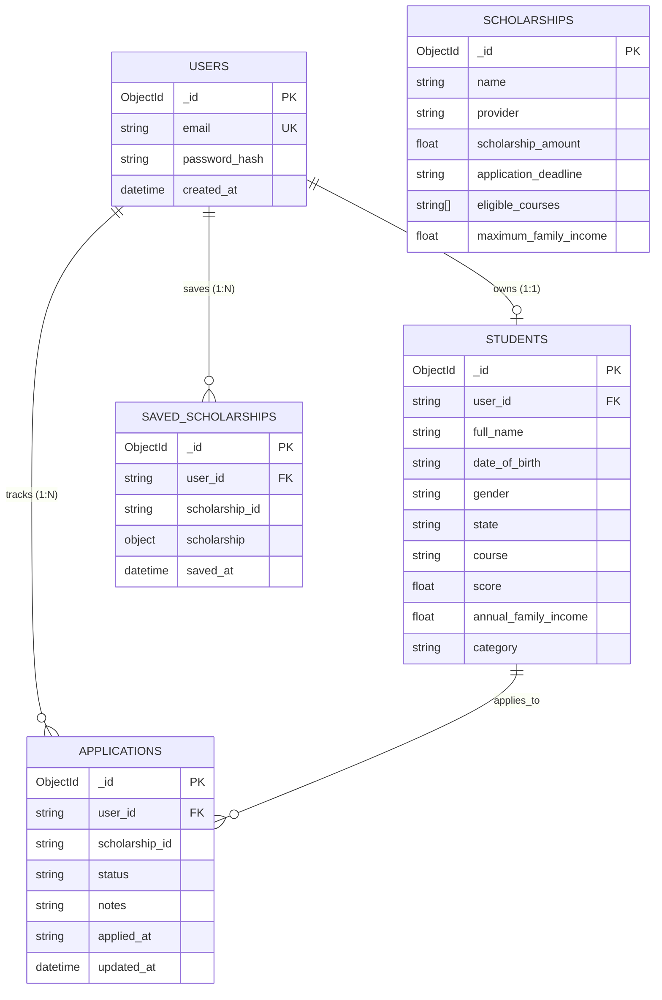

# Scholar AI — Database Architecture & Schema Reference

This document provides a technical specification of the MongoDB database implementation for **Scholar AI**. It documents the actual collections, schemas, data types, indexes, and relationship models in the production system.

---

## 1. Database Overview

- **Database Engine**: MongoDB Atlas (Cloud Managed Replica Set)
- **Database Driver**: `pymongo` (Synchronous Python MongoDB Client)
- **Database Name**: `scholar_ai` (Configurable via `MONGODB_DB` environment variable)
- **Connection Management**: Centralized singleton client in [`backend/app/database/connection.py`](file:///d:/Scholar AI/backend/app/database/connection.py) with automated `certifi.where()` TLS configuration for Windows environments.

---

## 2. Collections Overview

Scholar AI utilizes six dedicated collections:

| Collection Name | Primary Identifier | Purpose | Tenant / User Isolation |
| :--- | :--- | :--- | :--- |
| `users` | `_id` (`ObjectId`) | User credentials and authentication hashes | Global user record |
| `students` | `_id` (`ObjectId`) | Detailed student academic and demographic profile | Single student per `user_id` |
| `scholarships` | `_id` (`ObjectId`) | Pre-ingested or curated official scholarship schemes | Global public repository |
| `saved_scholarships` | `_id` (`ObjectId`) | Bookmarked scholarships per student | Scoped by `user_id` |
| `applications` | `_id` (`ObjectId`) | Application tracking statuses and records | Scoped by `user_id` |
| `search_cache` | `_id` (`ObjectId`) | Two-tier query & discovery cache with TTL index | Keyed by deterministic SHA-256 hash |

---

## 3. Detailed Collection Schemas

### 3.1. `users` Collection

Stores account authentication credentials.

```json
{
  "_id": { "$oid": "6724a1b2c3d4e5f6a7b8c9d0" },
  "email": "student@example.com",
  "password_hash": "$argon2id$v=19$m=65536,t=3,p=4$...",
  "created_at": { "$date": "2026-11-04T10:00:00.000Z" }
}
```

#### Field Specifications:
- `_id`: Unique identifier automatically generated by MongoDB.
- `email` (`str`): Lowercased, whitespace-trimmed student email address. Case-insensitive lookup supported.
- `password_hash` (`str`): Cryptographic hash. Generated using Argon2id by default. Legacy Bcrypt (`$2b$`) hashes are verified transparently and re-hashed to Argon2 upon successful login.
- `created_at` (`datetime`): UTC timestamp when user registered.

---

### 3.2. `students` Collection

Stores the student demographic, academic, and eligibility profile.

```json
{
  "_id": { "$oid": "6724a2c3d4e5f6a7b8c9d0e1" },
  "user_id": "6724a1b2c3d4e5f6a7b8c9d0",
  "full_name": "Tanish Sharma",
  "date_of_birth": "2003-08-15",
  "gender": "MALE",
  "state": "Maharashtra",
  "domicile_state": "Maharashtra",
  "education_level": "Undergraduate",
  "course": "B.Tech",
  "specialization": "Computer Science and Engineering",
  "college": "Pune Institute of Computer Technology",
  "academic_year": "3rd Year",
  "score": 84.5,
  "score_type": "percentage",
  "annual_family_income": 450000.0,
  "category": "OBC",
  "disability_status": false,
  "created_at": { "$date": "2026-11-04T10:15:00.000Z" },
  "updated_at": { "$date": "2026-11-04T10:15:00.000Z" }
}
```

#### Field Specifications:
- `user_id` (`str`): Foreign key referencing `users._id`. Enforces 1-to-1 profile mapping.
- `full_name` (`str`, Required): 2–100 characters.
- `date_of_birth` (`str`, Optional): ISO format `YYYY-MM-DD`. Used by `evaluate_age()`.
- `gender` (`str`, Optional): Normalized uppercase (e.g. `MALE`, `FEMALE`, `OTHER`).
- `state` / `domicile_state` (`str`, Optional): State of legal residence (e.g. `Maharashtra`, `Karnataka`).
- `education_level` (`str`, Optional): Current tier (`Undergraduate`, `Postgraduate`, `School`).
- `course` (`str`, Optional): Current degree program (`B.Tech`, `B.Sc`, `MBBS`, `Diploma`).
- `specialization` (`str`, Optional): Field of study (e.g. `Computer Science`, `Mechanical`).
- `college` (`str`, Optional): Institution name.
- `academic_year` (`str`, Optional): Academic progression (e.g. `1st Year`, `Final Year`).
- `score` (`float`, Optional): Numeric grade between 0 and 100.
- `score_type` (`str`, Optional): Metric type (`percentage` or `cgpa`).
- `annual_family_income` (`float`, Optional): Total household income in INR.
- `category` (`str`, Optional): Reservation category (`GENERAL`, `OBC`, `SC`, `ST`, `EWS`).
- `disability_status` (`bool`, Optional): Indicates person with disability (PwD).

---

### 3.3. `scholarships` Collection

Stores curated and pre-ingested official scholarship programs.

```json
{
  "_id": { "$oid": "6724a3d4e5f6a7b8c9d0e1f2" },
  "name": "Reliance Foundation Undergraduate Scholarship",
  "provider": "Reliance Foundation",
  "description": "Financial support up to graduation for undergraduate degree students across India.",
  "source_url": "https://www.reliancefoundation.org/scholarships",
  "eligible_categories": ["ALL"],
  "eligible_states": ["PAN INDIA"],
  "eligible_education_levels": ["Undergraduate"],
  "eligible_courses": ["B.Tech", "B.E.", "B.Sc", "B.Com"],
  "eligible_genders": ["ALL"],
  "maximum_family_income": 1500000.0,
  "minimum_score": 60.0,
  "minimum_score_type": "percentage",
  "minimum_age": 17,
  "maximum_age": 25,
  "disability_required": false,
  "scholarship_amount": 200000.0,
  "application_start_date": "2026-08-01",
  "application_deadline": "2026-11-30",
  "academic_year": "2026-2027",
  "verification_status": "OFFICIAL",
  "required_documents": [
    "Aadhaar Card",
    "Family Income Certificate",
    "Class 12 Marksheet",
    "College Admission Letter"
  ]
}
```

---

### 3.4. `saved_scholarships` Collection

Stores bookmarks saved by students. Supports external scholarships discovered dynamically from the live web without requiring a prior MongoDB `scholarships` record.

```json
{
  "_id": { "$oid": "6724a4e5f6a7b8c9d0e1f3a4" },
  "user_id": "6724a1b2c3d4e5f6a7b8c9d0",
  "scholarship_id": "https://scholarships.gov.in/postmatric-sc",
  "scholarship": {
    "id": "https://scholarships.gov.in/postmatric-sc",
    "name": "Post Matric Scholarship for SC Students",
    "provider": "Ministry of Social Justice and Empowerment",
    "scholarship_amount": "Full Tuition + ₹12,000",
    "application_deadline": "2026-12-31",
    "source_url": "https://scholarships.gov.in/postmatric-sc",
    "eligibility_status": "ELIGIBLE",
    "match_score": 96.0
  },
  "saved_at": { "$date": "2026-11-04T11:00:00.000Z" }
}
```

#### Indexing & Constraints:
- Compound Unique Index: `(user_id: 1, scholarship_id: 1)` prevents duplicate bookmarks.

---

### 3.5. `applications` Collection

Tracks the application lifecycle for scholarships applied to by the student.

```json
{
  "_id": { "$oid": "6724a5f6a7b8c9d0e1f3a4b5" },
  "user_id": "6724a1b2c3d4e5f6a7b8c9d0",
  "scholarship_id": "https://scholarships.gov.in/postmatric-sc",
  "scholarship_name": "Post Matric Scholarship for SC Students",
  "provider": "Ministry of Social Justice and Empowerment",
  "scholarship_amount": "Full Tuition + ₹12,000",
  "status": "UNDER_REVIEW",
  "applied_at": "2026-11-04",
  "notes": "Uploaded income certificate and bonafide form on portal.",
  "created_at": { "$date": "2026-11-04T11:30:00.000Z" },
  "updated_at": { "$date": "2026-11-04T12:00:00.000Z" }
}
```

#### Valid Lifecycle Status Values:
- `NOT_APPLIED`
- `APPLIED`
- `UNDER_REVIEW`
- `SELECTED`
- `REJECTED`

---

### 3.6. `search_cache` Collection

Stores evaluated web search results to prevent repetitive scraping and Serper.dev API credit exhaustion.

```json
{
  "_id": { "$oid": "6724a6a7b8c9d0e1f3a4b5c6" },
  "cache_type": "student_search",
  "cache_key": "e3b0c44298fc1c149afbf4c8996fb92427ae41e4649b934ca495991b7852b855",
  "data": {
    "student_id": "6724a2c3d4e5f6a7b8c9d0e1",
    "count": 14,
    "results": [ ... ]
  },
  "expires_at": { "$date": "2026-11-04T12:30:00.000Z" },
  "created_at": { "$date": "2026-11-04T12:00:00.000Z" },
  "updated_at": { "$date": "2026-11-04T12:00:00.000Z" }
}
```

#### Indexing & Automated Cleanup:
- **TTL Index**: `{ "expires_at": 1 }` with `expireAfterSeconds: 0`. MongoDB Atlas background thread automatically purges expired cache records.
- **Lookup Index**: Compound unique index `{ "cache_type": 1, "cache_key": 1 }`.

---

## 4. Entity-Relationship Model


