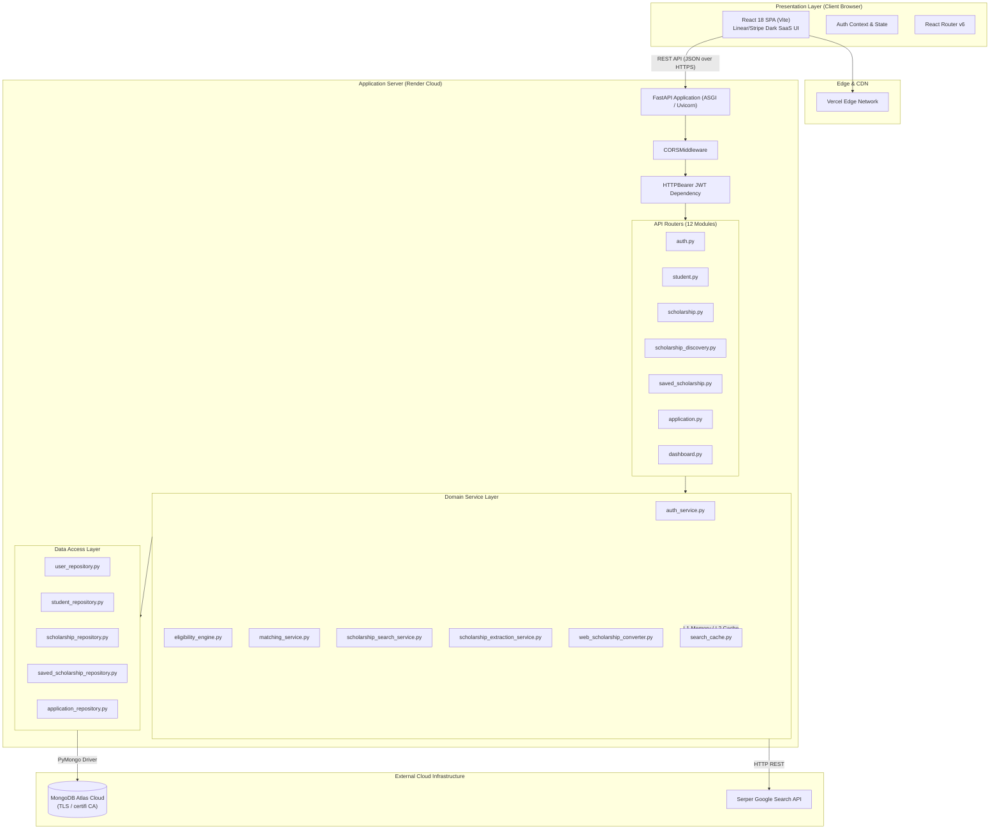
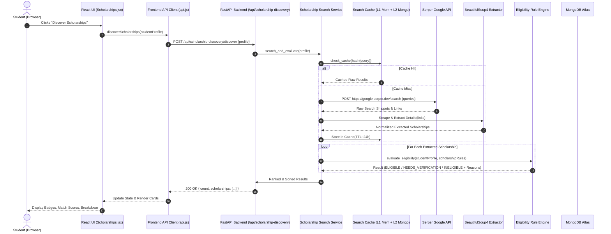
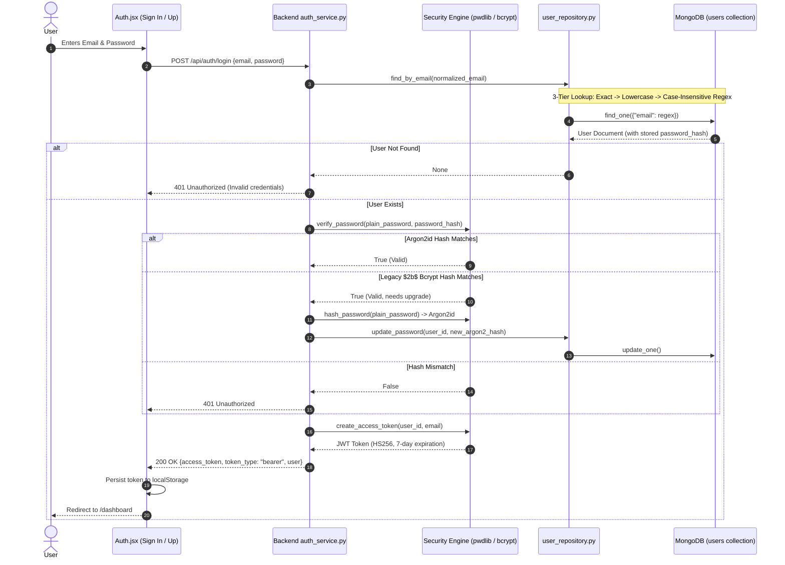
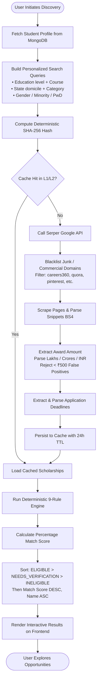
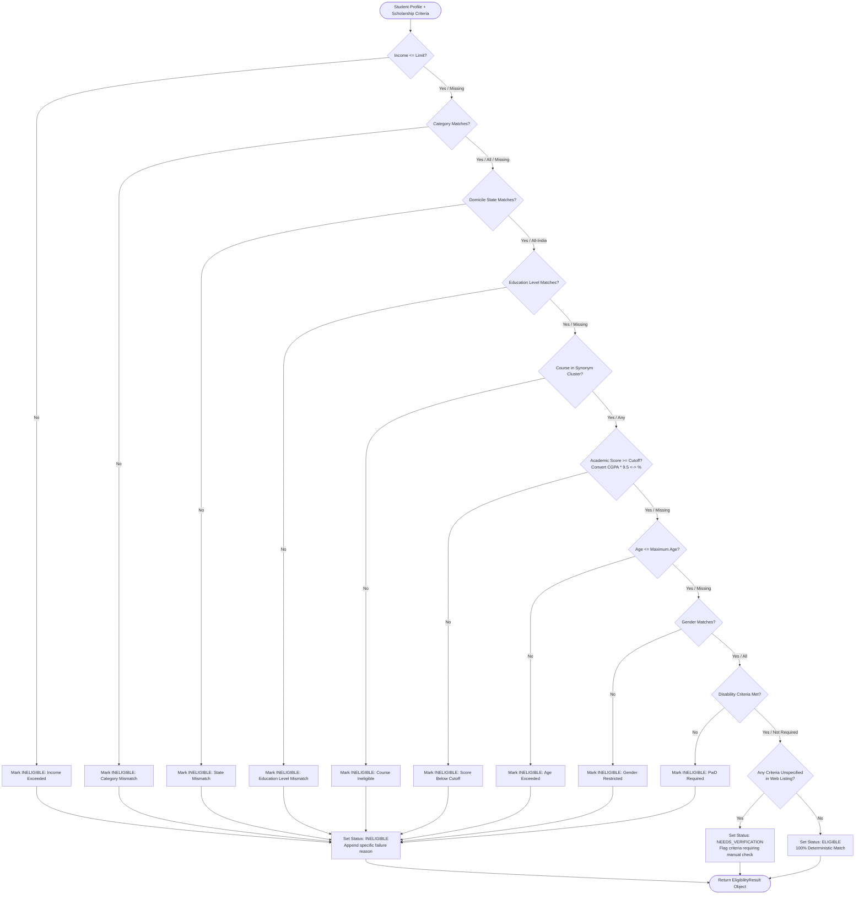
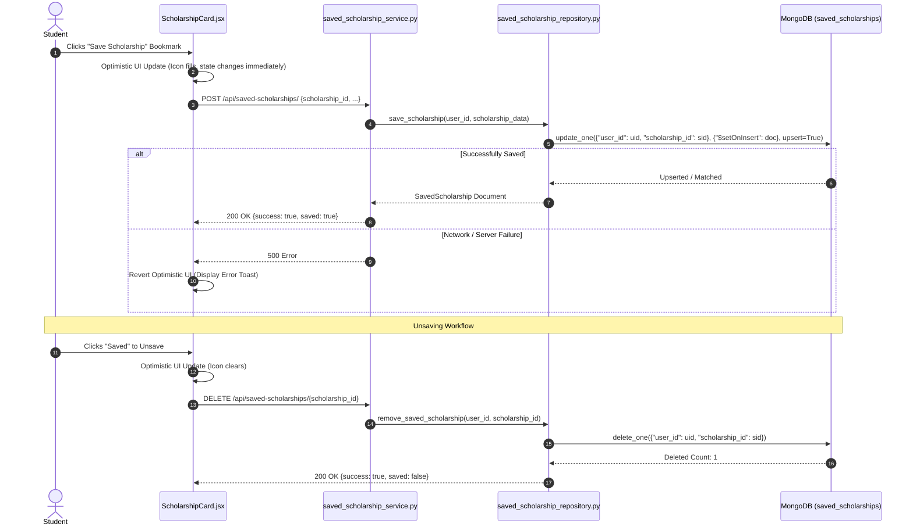
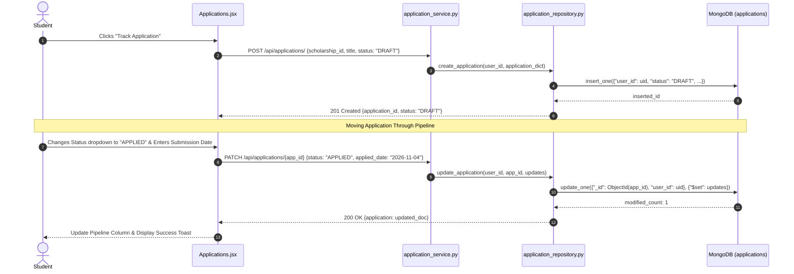
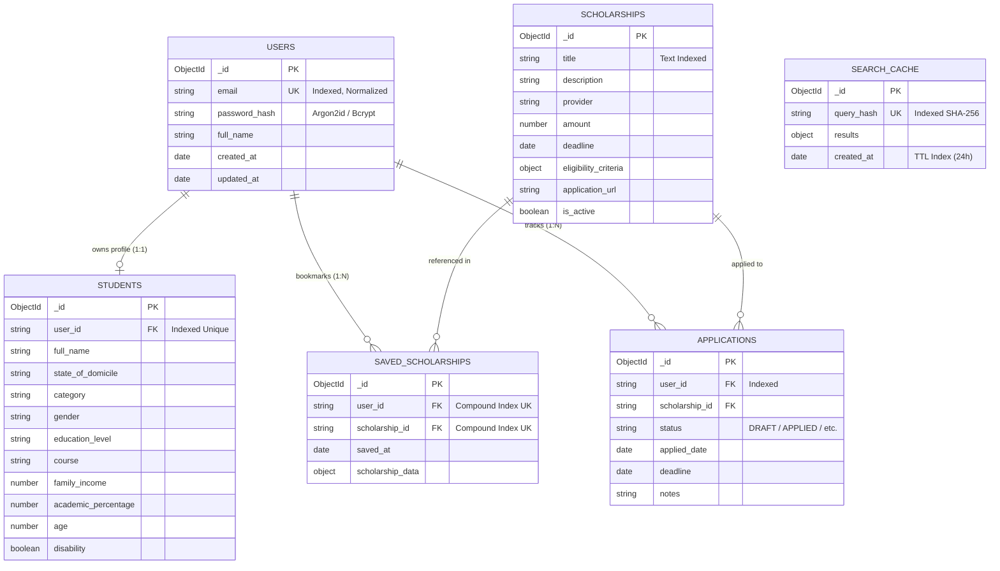

# Scholar AI — Complete Project Documentation

> **AI-Assisted Scholarship Discovery, Live Web Extraction & Deterministic Eligibility Matching Platform for Indian College Students**
>
> **Version:** 2.1.0  
> **Author & Architect:** Full-Stack AI Engineering Team  
> **Repository:** [Scholar AI](file:///d:/Scholar%20AI)  
> **Backend Framework:** FastAPI (Python 3.11+)  
> **Frontend Framework:** React 18 + Vite (SPA)  
> **Database:** MongoDB Atlas (PyMongo)  
> **Authentication:** Dual-Hasher Argon2id / Legacy Bcrypt + JWT (HS256)  

---

## Table of Contents

1. [Chapter 1: Project Introduction](#chapter-1-project-introduction)
2. [Chapter 2: Technology Stack](#chapter-2-technology-stack)
3. [Chapter 3: System Architecture](#chapter-3-system-architecture)
4. [Chapter 4: Repository and Folder Structure](#chapter-4-repository-and-folder-structure)
5. [Chapter 5: Frontend Implementation](#chapter-5-frontend-implementation)
6. [Chapter 6: Backend Implementation](#chapter-6-backend-implementation)
7. [Chapter 7: API Documentation](#chapter-7-api-documentation)
8. [Chapter 8: Database Documentation](#chapter-8-database-documentation)
9. [Chapter 9: Authentication and Security](#chapter-9-authentication-and-security)
10. [Chapter 10: Scholarship Discovery Pipeline](#chapter-10-scholarship-discovery-pipeline)
11. [Chapter 11: Eligibility Rule Engine](#chapter-11-eligibility-rule-engine)
12. [Chapter 12: Scholarship Matching and Scoring](#chapter-12-scholarship-matching-and-scoring)
13. [Chapter 13: Saved Scholarships Feature](#chapter-13-saved-scholarships-feature)
14. [Chapter 14: Application Tracker Feature](#chapter-14-application-tracker-feature)
15. [Chapter 15: Complete End-to-End Workflows](#chapter-15-complete-end-to-end-workflows)
16. [Chapter 16: Installation and Local Setup](#chapter-16-installation-and-local-setup)
17. [Chapter 17: Environment Variables Reference](#chapter-17-environment-variables-reference)
18. [Chapter 18: Testing and Quality Assurance](#chapter-18-testing-and-quality-assurance)
19. [Chapter 19: Deployment Guide](#chapter-19-deployment-guide)
20. [Chapter 20: Troubleshooting Guide](#chapter-20-troubleshooting-guide)
21. [Chapter 21: Technical Decisions and Tradeoffs](#chapter-21-technical-decisions-and-tradeoffs)
22. [Chapter 22: Limitations and Future Scope](#chapter-22-limitations-and-future-scope)
23. [Chapter 23: Complete Technical Interview Preparation](#chapter-23-complete-technical-interview-preparation)
24. [Chapter 24: Technical Glossary](#chapter-24-technical-glossary)

---

## Chapter 1: Project Introduction

### 1.1 Project Overview
**Scholar AI** is a full-stack, intelligent web platform designed to democratize higher education financial aid for Indian college and university students. The platform bridges the information gap between thousands of public, corporate CSR (Corporate Social Responsibility), non-governmental, and state-funded scholarship schemes and the students who desperately qualify for them.

By combining **live web search (Serper Google API)**, **automated document scraping & heuristic normalization (BeautifulSoup4)**, a **deterministic 9-point rule evaluation engine**, and an **application lifecycle tracker**, Scholar AI replaces fragmented, outdated blog posts with transparent, personalized, and actionable scholarship recommendations.

### 1.2 Problem Statement
In India, hundreds of crores in scholarship funds lapse or go unclaimed each academic year due to five systemic failure points:
1. **Severe Information Asymmetry:** Schemes are scattered across Central Government portals (NSP), State welfare portals (Mahadbt, e-Kalyan, OASIS), corporate CSR trusts (Tata, Reliance, Infosys, HDFC, Aditya Birla), and private NGOs.
2. **Ambiguous & Complex Eligibility Criteria:** Eligibility notices feature dense legal and academic criteria: income ceilings (often specified in Lakhs per annum), caste/social category tiers (General, OBC, SC, ST, EWS), domicile restrictions, minimum cut-offs (sometimes CGPA on a 10-point scale, sometimes percentage), age caps, gender quotas, and specific degree/course restrictions.
3. **Stale Information & Fraudulent Portals:** Many popular educational portals list expired scholarships with obsolete deadlines or host ad-heavy clickbait redirects designed to harvest student contact details without offering direct application links.
4. **Lack of Centralized Tracking:** Once a student discovers a scholarship, managing document submission, application deadlines, status tracking (Applied, Under Review, Awarded), and renewal timelines is completely manual.
5. **Opaque "Black-Box" Recommendations:** Typical AI or search systems return a list of links without explaining *why* the user is or is not eligible. A student rejected for being ₹10,000 over an income ceiling receives no transparent feedback.

### 1.3 Objectives
- **Targeted Discovery:** Generate personalized, context-aware Google Search queries utilizing the student's exact demographic, geographic, and academic attributes.
- **Automated Data Extraction & Sanitization:** Automatically fetch live web results, parse HTML, strip commercial clickbait domains, extract rupee award values (normalizing Lakh/Crore expressions), and detect deadlines.
- **Transparent Deterministic Eligibility:** Execute a strict, transparent 9-point eligibility audit (`ELIGIBLE`, `NEEDS_VERIFICATION`, `INELIGIBLE`) accompanied by human-readable explanations for every rule evaluated.
- **Accurate Mathematical Matching:** Compute a normalized match percentage based strictly on the ratio of passed criteria over evaluated criteria, prioritizing fully verified opportunities first.
- **End-to-End Application Lifecycle Management:** Empower students to save prospective scholarships to an isolated private profile and track application statuses through an interactive Kanban-style pipeline.

### 1.4 Target Users
- **Undergraduate & Postgraduate Students:** Enrolled in professional (B.Tech, MBBS, B.Arch, MBA) and general (B.Sc, B.Com, B.A., M.Sc) degree programs across India.
- **Economically Weaker Section (EWS) & Low-Income Families:** Students requiring fee subsidies whose family income falls below standard thresholds (₹1 Lakh, ₹2.5 Lakhs, ₹6 Lakhs, or ₹8 Lakhs per annum).
- **Reserved & Special Category Students:** SC, ST, OBC, EWS, and minority candidates seeking dedicated government welfare schemes.
- **Single Girl Child & Female Scholars:** Female students seeking gender-specific initiatives (e.g., Pragati Scholarship, UDAAN, L'Oréal For Women in Science).
- **Persons with Disabilities (PwD):** Differently abled scholars seeking specialized assistive and tuition grants.

### 1.5 Real-World Use Cases
1. **First-Generation Engineering Student:** A 2nd-year B.Tech student from Maharashtra with a family annual income of ₹2,20,000, belonging to the OBC category with an 8.2 CGPA, signs up. Scholar AI queries central and state portals, normalizes her 8.2 CGPA to 77.9%, verifies state domicile rules, and immediately surfaces the *Post-Matric Scholarship for OBC Students (Maharashtra)* and *HDFC Badhte Kadam Scholarship* with 100% eligibility badges.
2. **Medical Student Seeking Corporate CSR Support:** An MBBS student with an ₹8,00,000 annual fee burden searches for private CSR grants. The live extractor identifies merit-cum-means awards, parses award amounts up to ₹1,00,000, and isolates authentic application portals.
3. **Application Deadline Management:** A student managing three concurrent applications uses the Application Tracker to log submission dates, verify required documentation, and receive alerts on the Dashboard for approaching deadlines.

### 1.6 Project Scope & Limitations
- **Current Scope:** Live search across public web sources via Serper API, in-memory + MongoDB cache, deterministic 9-rule evaluation, multi-hash authentication, responsive Linear/Stripe SaaS UI, and private save/track persistence.
- **Current Limitations:** The platform does not submit applications on the student's behalf (government and CSR portals require direct Aadhaar biometric authentication or OTP verification). It relies on public web snippets and scraped HTML, which may occasionally contain ambiguous deadline phrasing requiring manual student verification.

---

## Chapter 2: Technology Stack

```
========================================================================================
                               SCHOLAR AI TECH STACK
========================================================================================
Frontend:       React 18 (SPA) | Vite 5 | React Router v6 | Vanilla Modern CSS
Backend:        FastAPI 0.115+ | Python 3.11+ | Pydantic v2 | Uvicorn
Database:       MongoDB Atlas (M0 Free Cloud Cluster) | PyMongo 4.6+
Authentication: Argon2id (pwdlib) + Legacy Bcrypt Fallback | PyJWT (HS256)
Web Services:   Serper Google Search API | BeautifulSoup4 | Requests | Certifi
Testing:        Pytest 8+ | Pytest-Asyncio | HTTPX | Unittest Mock
Deployment:     Render (Backend Web Service) | Vercel (Frontend Static Host)
========================================================================================
```

### 2.1 Frontend Technologies

#### React 18 (Single Page Application)
- **Role:** Drives the responsive user interface, component hierarchy, client-side routing, and real-time state synchronization.
- **Why Chosen:** Declarative UI model, virtual DOM reconciliation, rich ecosystem, and universal developer familiarity.
- **Key Modules Used:** Functional components, hooks (`useState`, `useEffect`, `useCallback`, `useMemo`, `useRef`, `useNavigate`, `useLocation`), custom context providers (`AuthContext`).

#### Vite 5
- **Role:** Next-generation frontend build tool and local development server.
- **Why Chosen:** Native ESM-based development server providing sub-50ms Hot Module Replacement (HMR) and optimized Rollup production bundling yielding sub-300ms builds.
- **Key Configuration:** Proxies `/api` routes during development to `http://127.0.0.1:8000` to prevent local CORS friction.

#### React Router v6
- **Role:** Declarative client-side routing, route protection guards, URL query parameter synchronization, and navigation state.
- **Key Implementation:** Handles seamless transitions between `/`, `/scholarships`, `/saved`, `/applications`, `/profile`, `/scholarship/:id`, and `/auth`.

#### Vanilla Modern CSS (Design System: Linear & Stripe SaaS)
- **Role:** Pure CSS custom property (variable) architecture without external heavy UI framework bloat (no Tailwind, MUI, or Bootstrap).
- **Design Aesthetic:** Deep space dark slate canvas (`#0B0F19`, `#111827`, `#1F2937`), electric indigo/violet gradients (`#6366F1` $\to$ `#8B5CF6`), translucent glassmorphism (`backdrop-filter: blur(16px)`), micro-interactions, and high-density information typography.

---

### 2.2 Backend Technologies

#### FastAPI (Python 3.11+)
- **Role:** High-performance, asynchronous REST API server.
- **Why Chosen:** Native Python type hints, automatic OpenAPI/Swagger documentation (`/docs`), async event loop integration, lightweight footprint, and built-in dependency injection system.
- **Architecture:** 12 modular routers connected via an async lifespan lifecycle manager.

#### Pydantic v2
- **Role:** Request and response data validation, strict schema enforcement, and type serialization.
- **Why Chosen:** Written in Rust core (`pydantic-core`) for blazingly fast validation; automatic JSON schema generation and field validators for data hygiene (e.g., whitespace trimming and lowercasing email strings).

#### PyMongo 4.6+ with MongoDB Atlas
- **Role:** Official synchronous Python driver connecting to cloud-hosted MongoDB Atlas clusters.
- **Why Chosen:** Schema flexibility accommodates diverse scholarship structures, rich document modeling, and native compound indexes. Configured with `certifi.where()` for robust SSL/TLS certificate chain resolution on Windows environments.

---

### 2.3 Security & Authentication Technologies

#### Argon2id (`pwdlib`) + Legacy Bcrypt Fallback
- **Role:** Industrial-grade password hashing engine.
- **Why Chosen:** Argon2id is the winner of the Password Hashing Competition (PHC), providing state-of-the-art resistance against GPU/ASIC brute-force attacks via tunable memory and time cost parameters.
- **Dual-Hasher Architecture:** Configured via `PasswordHash((Argon2Hasher(), BcryptHasher()))` with an automated fallback to `bcrypt.checkpw()`. Upon successful authentication of legacy `$2b$` Bcrypt hashes, the user's password hash is dynamically upgraded to Argon2id without interrupting the user.

#### PyJWT (JSON Web Tokens)
- **Role:** Stateless, cryptographically signed user session tokens.
- **Algorithm:** HMAC with SHA-256 (`HS256`).
- **Payload:** User ID (`sub`), email, issuer (`iss: scholar-ai`), and 7-day expiration (`exp`). Extracted securely via FastAPI `HTTPBearer` dependency.

---

### 2.4 Scraping & Search Services

#### Serper Google Search API
- **Role:** Fast, reliable Google Search engine API returning structured search snippets, organic results, knowledge graphs, and source URLs without IP blocking or CAPTCHA barriers.
- **Integration:** Asynchronous and synchronous fallback wrappers with dynamic query construction tailored to student academic profiles.

#### BeautifulSoup4 (`bs4`) & Requests
- **Role:** Web scraping, DOM traversal, and semantic text extraction.
- **Responsibilities:** Fetches target scholarship pages, removes script/style noise, strips boilerplate headers/footers, and extracts structured eligibility sentences, rupee award amounts, and deadline strings.

---

## Chapter 3: System Architecture

### 3.1 High-Level Architecture Overview
Scholar AI is structured as a decoupled, multi-tier client-server architecture:
1. **Presentation Layer (Frontend):** React SPA hosted on Vercel, interacting with backend services exclusively over HTTPS REST endpoints.
2. **API & Orchestration Layer (FastAPI):** Cloud-hosted on Render, managing CORS, rate limits, dependency injection, and router delegation.
3. **Domain Service Layer:** Pure business logic handling deterministic rule evaluation, score calculation, web scraping, and data normalization.
4. **Data Access Layer (Repositories):** Encapsulated MongoDB operations utilizing PyMongo with compound unique indexes.
5. **Persistence & External Service Layer:** MongoDB Atlas (M0 replica set) and Serper Google Search API.



---

### 3.2 Frontend-Backend Communication Flow



---

### 3.3 Authentication & Authorization Flow



---

### 3.4 Scholarship Discovery Workflow



---

### 3.5 Eligibility Evaluation Workflow



---

### 3.6 Saved Scholarship Workflow



---

### 3.7 Application Tracker Workflow



---

## Chapter 4: Repository and Folder Structure

The Scholar AI repository adheres to a clean separation of concerns:

```
d:\Scholar AI\
├── .gitignore                      # Git exclusion rules for node_modules, .venv, caches
├── README.md                       # Root production documentation and quickstart
├── package.json                    # Workspace metadata (if present)
│
├── backend\                        # FastAPI Backend Application Root
│   ├── .env                        # Local backend environment variables (excluded from Git)
│   ├── requirements.txt            # Python dependencies (FastAPI, PyMongo, Pydantic, etc.)
│   │
│   ├── app\                        # Application package root
│   │   ├── __init__.py             # Package marker
│   │   ├── main.py                 # FastAPI initialization, CORS, lifespan, router includes
│   │   │
│   │   ├── api\                    # API presentation layer (HTTP Routers)
│   │   │   ├── __init__.py
│   │   │   ├── application.py      # Application tracker routes (CRUD & status updates)
│   │   │   ├── auth.py             # User signup, login, and token issuance
│   │   │   ├── dashboard.py        # Aggregated stats, upcoming deadlines, activity counts
│   │   │   ├── eligibility.py      # Standalone eligibility evaluation endpoints
│   │   │   ├── explanation.py      # Natural language eligibility justification endpoints
│   │   │   ├── matching.py         # Match score calculation endpoints
│   │   │   ├── personalized_search.py # Search query generation based on student profile
│   │   │   ├── saved_scholarship.py# User bookmarking and saved scholarship routes
│   │   │   ├── scholarship.py      # Curated database scholarship CRUD routes
│   │   │   ├── scholarship_discovery.py # Live Serper search & extraction orchestration
│   │   │   ├── search.py           # Basic keyword search routes
│   │   │   └── student.py          # Student academic profile management routes
│   │   │
│   │   ├── core\                   # Cross-cutting infrastructure concerns
│   │   │   ├── __init__.py
│   │   │   ├── config.py           # Pydantic BaseSettings loading environment variables
│   │   │   ├── search_cache.py     # L1 memory + L2 MongoDB TTL search caching system
│   │   │   └── security.py         # Dual-hasher Argon2id/Bcrypt + JWT encoding/decoding
│   │   │
│   │   ├── database\               # Data access layer (MongoDB Repositories)
│   │   │   ├── __init__.py
│   │   │   ├── application_repository.py # PyMongo persistence for student applications
│   │   │   ├── collections.py      # Central collection accessors & index creation
│   │   │   ├── connection.py       # MongoClient singleton with certifi TLS CA integration
│   │   │   ├── saved_scholarship_repository.py # Persistence for saved bookmarks
│   │   │   ├── scholarship_repository.py # Persistence for curated scholarships
│   │   │   ├── student_repository.py # Persistence for student demographic profiles
│   │   │   └── user_repository.py  # User credentials and 3-tier lookup engine
│   │   │
│   │   ├── models\                 # Low-level data structures & MongoDB representations
│   │   │   ├── __init__.py
│   │   │   ├── application.py      # Application domain model
│   │   │   ├── eligibility_rule.py # Rule definitions for income, category, state, etc.
│   │   │   ├── scholarship.py      # Database scholarship representation
│   │   │   └── student.py          # Student profile database representation
│   │   │
│   │   ├── schemas\                # Pydantic validation models (Request/Response DTOs)
│   │   │   ├── __init__.py
│   │   │   ├── application.py      # CreateApplicationRequest, ApplicationResponse
│   │   │   ├── auth.py             # UserRegister, UserLogin, TokenResponse
│   │   │   ├── dashboard.py        # DashboardSummaryResponse
│   │   │   ├── eligibility.py      # EligibilityEvaluationRequest, RuleResultResponse
│   │   │   ├── matching.py         # MatchScoreRequest, MatchScoreResponse
│   │   │   ├── saved_scholarship.py# SavedScholarshipCreate, SavedScholarshipResponse
│   │   │   ├── scholarship.py      # ScholarshipBase, ScholarshipDetailResponse
│   │   │   ├── search.py           # SearchFilterRequest, SearchQueryResponse
│   │   │   ├── student.py          # StudentProfileCreate, StudentProfileUpdate
│   │   │   └── user.py             # UserProfileResponse, EmailValidationSchema
│   │   │
│   │   ├── search\                 # Search client wrappers
│   │   │   ├── __init__.py
│   │   │   └── web_search.py       # Serper Google Search API client
│   │   │
│   │   └── services\               # Pure domain business logic layer
│   │       ├── __init__.py
│   │       ├── application_service.py # Application tracking lifecycle business logic
│   │       ├── auth_service.py     # User registration, authentication & password upgrade
│   │       ├── dashboard_service.py# Dashboard metric computation & deadline alerts
│   │       ├── eligibility_engine.py # Core deterministic 9-point rule evaluation engine
│   │       ├── matching_service.py # Match percentage calculation & rank sorting
│   │       ├── scholarship_extraction_service.py # BeautifulSoup4 scraping & amount parsing
│   │       ├── scholarship_search_service.py # Search orchestration & query synthesis
│   │       ├── web_eligibility_parser.py # Regex extraction of rules from web text
│   │       ├── web_eligibility_service.py # Evaluation of live web scholarship data
│   │       └── web_scholarship_converter.py # Raw web data to structured schema converter
│   │
│   └── tests\                      # Pytest automated test suite (53 passing tests)
│       ├── __init__.py
│       ├── conftest.py             # Shared fixtures (in-memory mock DB, sample profiles)
│       ├── test_application_service.py # Test application state transitions & tracking
│       ├── test_auth_login_resilience.py # Test case sensitivity, whitespace & lookups
│       ├── test_auth_security.py   # Test Argon2id hashing, Bcrypt upgrade & JWT tokens
│       ├── test_dashboard_deadlines.py # Test deadline parsing & urgent alert logic
│       ├── test_eligibility_engine_enhancements.py # Test 9 rules, synonyms, conversions
│       ├── test_saved_repository_duplicates.py # Test compound index uniqueness
│       ├── test_saved_scholarship_service.py # Test bookmark business logic
│       ├── test_saved_scholarships_api.py # Test save/unsave REST endpoints
│       ├── test_scholarship_extraction.py # Test rupee parser, blacklist & false positives
│       ├── test_search_cache.py    # Test L1/L2 caching, SHA-256 keys & circuit breaker
│       ├── test_web_converter.py   # Test schema normalization for web scraped objects
│       └── test_web_eligibility_parser.py # Test regex criteria parsing from raw HTML
│
├── frontend\                       # React Single Page Application Root
│   ├── index.html                  # HTML5 entry point with Inter font & viewport meta
│   ├── package.json                # Frontend dependencies & npm scripts (vite, react, etc.)
│   ├── vite.config.js              # Vite configuration & development proxy setup
│   │
│   ├── src\                        # Frontend source code
│   │   ├── main.jsx                # React root mount (createRoot) with BrowserRouter
│   │   ├── App.jsx                 # Application shell, route mapping & AuthProvider wrap
│   │   ├── App.css                 # Linear/Stripe SaaS design system & responsive styling
│   │   │
│   │   ├── components\             # Reusable UI components
│   │   │   ├── Icons.jsx           # Crisp SVG icon library (Lucide-inspired)
│   │   │   ├── Layout.jsx          # SaaS Shell with sidebar, breadcrumbs & user pill
│   │   │   └── ScholarshipCard.jsx # High-density card with match score, badges & save
│   │   │
│   │   ├── context\                # Global state management
│   │   │   └── AuthContext.jsx     # User authentication state, token storage & logout
│   │   │
│   │   ├── pages\                  # Top-level view pages
│   │   │   ├── Applications.jsx    # Application Tracker with status columns & modals
│   │   │   ├── Auth.jsx            # Sign In / Sign Up tabbed form with live feedback
│   │   │   ├── Dashboard.jsx       # Overview, profile completion %, metrics & deadlines
│   │   │   ├── Details.jsx         # In-depth scholarship view with rule breakdown
│   │   │   ├── Profile.jsx         # 12-field student demographic & academic editor
│   │   │   ├── Saved.jsx           # Bookmarked scholarships collection view
│   │   │   └── Scholarships.jsx    # Live discovery engine with search filters & tabs
│   │   │
│   │   └── services\               # Frontend HTTP API client
│   │       └── api.js              # Fetch wrappers, JWT injection & error handling
│   │
│   └── public\                     # Static public assets (favicons, manifest)
│
└── docs\                           # Comprehensive Documentation Suite
    ├── API_DOCUMENTATION.md        # Complete 12-router REST endpoint reference
    ├── ARCHITECTURE.md             # High-level architecture & 7 Mermaid diagrams
    ├── DATABASE_DOCUMENTATION.md   # MongoDB Atlas collections, schemas & indexes
    ├── INTERVIEW_PREPARATION.md    # Elevator pitches, deep Q&A & debugging case studies
    ├── SETUP_AND_DEPLOYMENT.md     # Local setup guide & cloud deployment instructions
    ├── CHANGELOG.md                # Detailed release notes & commit history
    └── SCHOLAR_AI_COMPLETE_DOCUMENTATION.md # This 24-chapter master document
```

---

## Chapter 5: Frontend Implementation

### 5.1 Architecture & Design System
The frontend is constructed using React 18, bundled with Vite 5, and styled using a custom CSS system inspired by **Linear** and **Stripe**. The UI emphasizes visual hierarchy, high density of actionable data, sub-50ms interaction feedback, and glassmorphic micro-details.

#### Visual Palette & Design Tokens (`App.css`)
- **Background Slate:** Deep space dark canvas (`#0B0F19`) paired with elevated card surfaces (`#111827`, `#1F2937`).
- **Brand Accents:** Electric Indigo (`#6366F1`) and Violet (`#8B5CF6`) gradients for primary calls to action, active sidebar links, and match score rings.
- **Semantic Badges:**
  - *Eligible / High Match:* Emerald Green (`#10B981`, background `rgba(16, 185, 129, 0.12)`).
  - *Needs Verification / Medium Match:* Amber Gold (`#F59E0B`, background `rgba(245, 158, 11, 0.12)`).
  - *Ineligible / Low Match:* Crimson Rose (`#EF4444`, background `rgba(239, 68, 68, 0.12)`).
- **Typography:** Inter sans-serif typeface paired with monospace numbers for financial figures and percentage scores.

---

### 5.2 Key Frontend Components

#### 1. `Layout.jsx` ([Layout.jsx](file:///d:/Scholar%20AI/frontend/src/components/Layout.jsx))
- **Responsibilities:** Renders the persistent left navigation sidebar, breadcrumb trail, user profile pill, and dynamic content viewport.
- **Key Features:**
  - Active route highlighting with glow indicators.
  - Collapsible mobile navigation drawer with hamburger toggle.
  - Safe desktop layout without duplicate bottom navigation bars.
  - Direct logout trigger tied to `AuthContext`.

#### 2. `ScholarshipCard.jsx` ([ScholarshipCard.jsx](file:///d:/Scholar%20AI/frontend/src/components/ScholarshipCard.jsx))
- **Responsibilities:** Displays individual scholarship summaries across Discovery, Saved, and Dashboard views.
- **Key Features:**
  - Radial match percentage badge with dynamic color transitions ($>75\%$ emerald, $50\text{--}74\%$ amber, $<50\%$ rose).
  - Parsed award amount highlighted in prominent bold rupee figures (e.g., `₹50,000 / year`).
  - Deadline countdown pill indicating remaining days with warning colors for urgent cut-offs.
  - Optimistic Save/Unsave bookmark button with instant visual response.
  - Direct link to official application portal (with `rel="noopener noreferrer"` security flags) and "View Details" modal navigation.

#### 3. `Icons.jsx` ([Icons.jsx](file:///d:/Scholar%20AI/frontend/src/components/Icons.jsx))
- **Responsibilities:** Self-contained SVG icon repository providing crisp, lightweight iconography (GraduationCap, Search, Bookmark, Briefcase, User, Sparkles, Filter, CheckCircle, AlertTriangle, XCircle, etc.) without third-party icon bundle bloat.

---

### 5.3 Page Breakdown & State Flows

#### 1. `Dashboard.jsx` ([Dashboard.jsx](file:///d:/Scholar%20AI/frontend/src/pages/Dashboard.jsx))
- **Purpose:** Serves as the central command hub for the student upon logging in.
- **Capabilities:**
  - Computes and displays real-time **Profile Strength** (0% to 100%) checking all current and legacy property aliases (`annual_family_income`, `domicile_state`, `score`, etc.).
  - Displays aggregated metric counters: *Matching Scholarships*, *Saved Bookmarks*, *Applications in Progress*, and *Total Award Potential*.
  - Alerts student to urgent upcoming application deadlines (within 7, 14, or 30 days).
  - Quick action shortcuts to trigger live discovery or edit profile.

#### 2. `Scholarships.jsx` ([Scholarships.jsx](file:///d:/Scholar%20AI/frontend/src/pages/Scholarships.jsx))
- **Purpose:** Primary scholarship discovery and exploration interface.
- **Capabilities:**
  - Dual modes: *Curated Scholarships* (curated database records) and *Live AI Discovery* (real-time Serper scraping & evaluation).
  - Multi-tier filtering controls: Filter by Minimum Match Score, Category, Education Level, State, and Search Query keywords.
  - Tabbed category switching: *All*, *Eligible Only*, *Needs Verification*, *High Value (>₹50,000)*.
  - Loading skeleton indicators during live search pipeline execution.

#### 3. `Saved.jsx` ([Saved.jsx](file:///d:/Scholar%20AI/frontend/src/pages/Saved.jsx))
- **Purpose:** Private student repository of bookmarked scholarship opportunities.
- **Capabilities:**
  - Fetches saved records directly from `/api/saved-scholarships/`.
  - Enables instant removal (unsave) with optimistic UI updates.
  - Quick "Apply Now" launchpad directing students to official external application portals.
  - Direct bridge to add any saved scholarship into the Application Tracker.

#### 4. `Applications.jsx` ([Applications.jsx](file:///d:/Scholar%20AI/frontend/src/pages/Applications.jsx))
- **Purpose:** Full lifecycle application management pipeline.
- **Capabilities:**
  - Five distinct pipeline stages: `DRAFT`, `APPLIED`, `UNDER_REVIEW`, `ACCEPTED`, `REJECTED`, `AWARDED`.
  - Application editing modal: update submission dates, application reference IDs, uploaded document checklists, and personal interview notes.
  - Instant status transition buttons to advance applications through stages.

#### 5. `Profile.jsx` ([Profile.jsx](file:///d:/Scholar%20AI/frontend/src/pages/Profile.jsx))
- **Purpose:** Student academic, geographic, and demographic data configuration.
- **Fields Managed:**
  - Full Name, Email (read-only/synchronized), Phone Number.
  - State of Domicile (Indian States & UTs dropdown).
  - Social Category (`GENERAL`, `OBC`, `SC`, `ST`, `EWS`).
  - Gender (`MALE`, `FEMALE`, `OTHER`).
  - Education Level (`10TH`, `12TH`, `DIPLOMA`, `UNDERGRADUATE`, `POSTGRADUATE`, `PHD`).
  - Degree Course (B.Tech, MBBS, B.Com, B.Sc, BCA, etc.) and Specialization.
  - Annual Family Income (INR numeric ceiling).
  - Academic Score (Percentage or CGPA on a 10-point scale).
  - Age (in years) and Disability Status (Yes/No with percentage).
- **Validation:** Live input bounds checking (e.g., CGPA $\le 10$, percentage $\le 100$, income $\ge 0$).

#### 6. `Details.jsx` ([Details.jsx](file:///d:/Scholar%20AI/frontend/src/pages/Details.jsx))
- **Purpose:** In-depth audit view of a single scholarship's eligibility breakdown.
- **Capabilities:**
  - Displays full scheme description, award breakdown, application process, and official links.
  - Visual **Rule-by-Rule Audit Matrix**: Renders green checkmarks for passed rules, amber warnings for rules needing verification, and red crosses for failed rules with specific justifications.

#### 7. `Auth.jsx` ([Auth.jsx](file:///d:/Scholar%20AI/frontend/src/pages/Auth.jsx))
- **Purpose:** User authentication portal supporting Sign In and Sign Up.
- **Capabilities:**
  - Tabbed interface with seamless switching.
  - Client-side validation: email format regex, password length ($\ge 6$ characters), confirmation matching.
  - Automatic token persistence to `localStorage` and global `AuthContext` initialization upon success.

---

## Chapter 6: Backend Implementation

### 6.1 Application Architecture & Lifespan
The backend is built with FastAPI, adhering to a strict **Controller-Service-Repository** design pattern. The application lifecycle is governed by an asynchronous `lifespan` context manager in `app/main.py`:

```python
@asynccontextmanager
async def lifespan(app: FastAPI):
    # Startup: Initialize MongoDB indexes and verify database connectivity
    init_db()
    yield
    # Shutdown: Clean up connection pools and cached handles
    close_db()
```

### 6.2 CORS & Security Middleware
`app/main.py` configures `CORSMiddleware` with explicit origin whitelisting:
- Local development origins: `http://localhost:5173`, `http://127.0.0.1:5173`, `http://localhost:3000`.
- Deployed production origins: `https://scholar-ai.vercel.app`, Vercel preview deployment wildcards, and Render backend URLs.
- Allows standard HTTP methods (`GET`, `POST`, `PUT`, `PATCH`, `DELETE`, `OPTIONS`) and credentials headers (`Authorization`, `Content-Type`).

---

### 6.3 Layered Architecture Details

```
+-------------------------------------------------------------+
|                     API Routers (12)                        |
| - Parameter extraction, auth injection, Pydantic validation |
+------------------------------+------------------------------+
                               |
                               v
+-------------------------------------------------------------+
|                     Domain Services                         |
| - Pure business logic: rules, scoring, parsing, scraping     |
+------------------------------+------------------------------+
                               |
                               v
+-------------------------------------------------------------+
|                  Database Repositories                      |
| - Encapsulated PyMongo queries, projections, upserts        |
+------------------------------+------------------------------+
                               |
                               v
+-------------------------------------------------------------+
|                     MongoDB Atlas                           |
| - Collections: users, students, scholarships, etc.          |
+-------------------------------------------------------------+
```

1. **Routers (`app/api/`):** Thin HTTP controllers. They do not execute database queries or business algorithms directly; they validate inputs via Pydantic schemas, verify JWT tokens using FastAPI's `Depends(get_current_user)`, call the service layer, and return typed responses.
2. **Services (`app/services/`):** Stateless business logic handlers. They execute algorithmic workflows: computing match percentages, running the 9-point rule engine, querying Serper, scraping HTML with BeautifulSoup, and sanitizing extracted text.
3. **Repositories (`app/database/`):** Pure data access objects. They encapsulate PyMongo calls, map BSON `_id` to string IDs, handle compound uniqueness constraints, and manage database projections.
4. **Core Infrastructure (`app/core/`):** Manages configuration (`config.py`), cryptographic hashing and token signing (`security.py`), and two-tier search caching (`search_cache.py`).

---

## Chapter 7: API Documentation

Scholar AI provides 12 dedicated REST API routers exposing 32 endpoints. Complete details, schemas, and status codes are fully referenced below.

### 7.1 Router Overview Table

| Router Prefix | Responsibility | Auth Required | Key Endpoints |
| :--- | :--- | :---: | :--- |
| `/api/auth` | User registration, authentication, token refresh | No (public) | `POST /register`, `POST /login`, `GET /me` |
| `/api/student` | Student demographic & academic profiles | Yes (Bearer) | `GET /profile`, `POST /profile`, `PUT /profile` |
| `/api/scholarships` | Curated database scholarships CRUD | Read: No / Write: Yes | `GET /`, `GET /{id}`, `POST /` |
| `/api/eligibility` | Standalone eligibility rule evaluation | Yes (Bearer) | `POST /evaluate`, `POST /batch-evaluate` |
| `/api/matching` | Match scoring & ranking algorithms | Yes (Bearer) | `POST /score`, `POST /rank` |
| `/api/explanation`| Natural language eligibility reasons | Yes (Bearer) | `POST /explain` |
| `/api/dashboard` | Dashboard metrics, stats & urgent deadlines | Yes (Bearer) | `GET /stats`, `GET /deadlines` |
| `/api/saved-scholarships` | Bookmark saving, unsaving & listing | Yes (Bearer) | `GET /`, `POST /`, `DELETE /{id}` |
| `/api/applications` | Application tracking pipeline & status updates | Yes (Bearer) | `GET /`, `POST /`, `PATCH /{id}`, `DELETE /{id}` |
| `/api/search` | Full-text & filtered database search | No (public) | `GET /` |
| `/api/personalized-search` | Personalized search query generator | Yes (Bearer) | `POST /generate-queries` |
| `/api/scholarship-discovery` | Live Google Serper search & extraction | Yes (Bearer) | `POST /discover` |

*(Refer to [API_DOCUMENTATION.md](file:///d:/Scholar%20AI/docs/API_DOCUMENTATION.md) for full request/response JSON schemas for every endpoint).*

---

## Chapter 8: Database Documentation

The platform uses **MongoDB Atlas** (Cloud Replica Set). PyMongo communicates with the database using TLS encryption verified via `certifi.where()`.

### 8.1 Collections & Index Architecture



### 8.2 Compound & Performance Indexes
1. `users.email`: Unique index ensuring no duplicate accounts exist.
2. `students.user_id`: Unique index enforcing a strict 1-to-1 relationship between an authenticated user and their academic profile.
3. `saved_scholarships.(user_id, scholarship_id)`: **Compound Unique Index** preventing a user from bookmarking the same scholarship twice, guaranteeing idempotency.
4. `applications.(user_id, scholarship_id)`: Fast compound lookup index for checking application status.
5. `search_cache.created_at`: **MongoDB TTL (Time-To-Live) Index** set to expire documents automatically after 86,400 seconds (24 hours).

*(Refer to [DATABASE_DOCUMENTATION.md](file:///d:/Scholar%20AI/docs/DATABASE_DOCUMENTATION.md) for complete collection schemas and JSON samples).*

---

## Chapter 9: Authentication and Security

### 9.1 Multi-Hasher Architecture & Automatic Upgrades
To resolve password hash compatibility across legacy migrations while upholding top-tier cryptographic security, Scholar AI implements a dual-hasher security architecture in `backend/app/core/security.py`:

```
Incoming Password 
       |
       v
Check Hasher Format
   ├── Starts with "$argon2id$" ──> Verify with Argon2id ──> Success!
   │
   └── Starts with "$2b$" / "$2a$" ──> Verify with Bcrypt Fallback
                                            │
                                            ├── Valid Password?
                                            │        │
                                            │        └── YES ──> Re-hash to Argon2id
                                            │                     Update User Record in DB!
                                            └── Invalid Password? ──> 401 Unauthorized
```

### 9.2 3-Tier Email Normalization & Lookup
To eliminate user login failures caused by accidental trailing spaces or inconsistent casing (e.g., `User@example.com` vs `user@example.com `), `user_repository.py` implements a resilient 3-tier lookup:
1. **Tier 1 (Exact Match):** Direct match on the input string.
2. **Tier 2 (Lowercase Normalized):** Matches `email.strip().lower()`.
3. **Tier 3 (Case-Insensitive Regex Anchor):** Queries MongoDB using `{"email": {"$regex": f"^{re.escape(cleaned)}$", "$options": "i"}}`.

### 9.3 JWT Token Lifecycle
- **Algorithm:** `HS256` signed using a cryptographically secure `SECRET_KEY`.
- **Payload Claims:**
  - `sub`: User ID string (`ObjectId`).
  - `email`: User's primary email.
  - `iss`: `"scholar-ai"`.
  - `exp`: Unix timestamp representing 7 days from token issuance.
- **Client Handling:** Stored in browser `localStorage`; injected via HTTP `Authorization: Bearer <token>` header on all protected API calls.

---

## Chapter 10: Scholarship Discovery Pipeline

The scholarship discovery pipeline bridges the real-time public web with student profiles.

```
Personalized Profile
        │
        ▼
Query Synthesis ──► [ "B.Tech OBC scholarships Maharashtra", "engineering girls scholarship" ]
        │
        ▼
Deterministic Hash ──► SHA-256("query_string_and_params")
        │
        ├── [Cache Hit] ──► Fetch from L1 Memory or L2 MongoDB (Sub-5ms)
        │
        └── [Cache Miss] ──► Serper Google Search API
                                   │
                                   ▼
                         Domain Blacklist Filter
                         (Drops: quora, pinterest, careers360 clickbait)
                                   │
                                   ▼
                         HTML Scraper & BS4 Parser
                                   │
                                   ▼
                         Heuristic Rule Extractors
                         - Rupee Parser (₹, Lakhs, Crores, >= ₹500 floor)
                         - Deadline Regex (DD/MM/YYYY, Month DD, YYYY)
                         - Criteria Tokenizer (income, category, course)
                                   │
                                   ▼
                         Cache Results (24h TTL)
                                   │
                                   ▼
                         Eligibility Engine & Scoring
```

### 10.1 Rupee Award Amount Extraction Heuristic
Extracting financial award amounts from arbitrary web text requires differentiating between actual scholarship stipends and irrelevant stray numbers (e.g., "Section 2", "Page 5", "₹2 processing fee").

`scholarship_extraction_service.py` implements:
1. **Lakh & Crore Multipliers:** Captures expressions like `"₹2.5 Lakhs"`, `"Rs 1.5 Lakh per annum"`, and converts them to integer rupees (`250000`).
2. **Direct Numeric INR Extraction:** Captures formats like `"₹50,000"`, `"INR 75,000"`, `"Rs. 25,000/-"`.
3. **The ₹500 Minimum Floor Guard:** Rejects extracted numbers below ₹500, eliminating erroneous low-digit false positives (fixing legacy bugs where "Part 2" resulted in a scholarship award of ₹2).

---

## Chapter 11: Eligibility Rule Engine

Scholar AI's eligibility engine (`backend/app/services/eligibility_engine.py`) evaluates 9 distinct criteria. Rather than using an unexplainable "black-box" machine learning model, it uses a **transparent, deterministic rule-based evaluation** model.

### 11.1 The 9 Evaluation Rules

| # | Rule Name | Evaluation Logic | Result States |
| :---: | :--- | :--- | :--- |
| **1** | **Income Rule** | Verifies `student.family_income <= scholarship.max_income`. If student income is within threshold, returns `PASSED`. If exceeded, returns `FAILED` with exact difference. | `PASSED`, `FAILED`, `NOT_APPLICABLE` |
| **2** | **Category Rule** | Compares `student.category` against allowed categories (`GENERAL`, `OBC`, `SC`, `ST`, `EWS`). If scholarship is open to all, passes automatically. | `PASSED`, `FAILED`, `NOT_APPLICABLE` |
| **3** | **State Domicile Rule**| Verifies student's state of domicile against scholarship restrictions. Allows `All India` or matching state codes. | `PASSED`, `FAILED`, `NOT_APPLICABLE` |
| **4** | **Education Level Rule**| Validates current education level (`10TH`, `12TH`, `DIPLOMA`, `UNDERGRADUATE`, `POSTGRADUATE`, `PHD`). | `PASSED`, `FAILED`, `NOT_APPLICABLE` |
| **5** | **Course Synonym Rule**| Matches degree courses using semantic synonym clusters (e.g., `["btech", "b.tech", "be", "b.e.", "engineering"]`). | `PASSED`, `FAILED`, `NOT_APPLICABLE` |
| **6** | **Score Cutoff Rule** | Converts CGPA to percentage using standard CBSE/AICTE formula ($\text{Percentage} = \text{CGPA} \times 9.5$). Evaluates against cut-off. | `PASSED`, `FAILED`, `NOT_APPLICABLE` |
| **7** | **Age Limit Rule** | Verifies `student.age <= scholarship.max_age`. | `PASSED`, `FAILED`, `NOT_APPLICABLE` |
| **8** | **Gender Rule** | Enforces gender criteria (e.g., female-only schemes like *Pragati*). Matches `student.gender`. | `PASSED`, `FAILED`, `NOT_APPLICABLE` |
| **9** | **Disability Rule** | If scholarship specifies PwD quota, verifies `student.disability == True`. | `PASSED`, `FAILED`, `NOT_APPLICABLE` |

### 11.2 Status Classification Matrix
- **`ELIGIBLE`:** Every specified criteria evaluated resulted in `PASSED`. The student qualifies for this opportunity.
- **`NEEDS_VERIFICATION`:** No criteria failed, but one or more rules could not be definitively evaluated because the scraped web listing did not explicitly state the parameter (e.g., income ceiling unspecified in snippet).
- **`INELIGIBLE`:** At least one mandatory criterion resulted in `FAILED` (e.g., family income exceeded, category mismatch, state mismatch).

---

## Chapter 12: Scholarship Matching and Scoring

The match score is a normalized mathematical representation of how closely a student satisfies a scholarship's collective criteria.

### 12.1 Mathematical Formulation

$$\text{Evaluated Rules} = \text{Passed Rules} + \text{Failed Rules}$$

$$\text{Match Percentage} = \begin{cases} 
100.0, & \text{if Evaluated Rules} = 0 \\
\operatorname{round}\left(\left(\frac{\text{Passed Rules}}{\text{Evaluated Rules}}\right) \times 100, 2\right), & \text{if Evaluated Rules} > 0 
\end{cases}$$

### 12.2 Multi-Tier Sorting Hierarchy
Results are sorted using a strict tuple-based ranking hierarchy:
1. **Status Priority (Descending):**
   - `ELIGIBLE` $\to$ Rank 1
   - `NEEDS_VERIFICATION` $\to$ Rank 2
   - `INELIGIBLE` $\to$ Rank 3
2. **Match Score (Descending):** Highest percentage match appears first.
3. **Alphabetical Title (Ascending):** Secondary tie-breaker for consistent UI ordering.

### 12.3 Worked Scoring Example
A student profile is evaluated against a Corporate Engineering Scholarship:
- **Criteria 1 (Income):** Student: ₹2.4 Lakhs, Limit: ₹5.0 Lakhs $\to$ **PASSED**
- **Criteria 2 (Category):** Scholarship: Open to all $\to$ **PASSED**
- **Criteria 3 (Course):** Student: B.Tech, Required: Engineering $\to$ **PASSED**
- **Criteria 4 (Score):** Student: 68%, Cut-off: 75% $\to$ **FAILED**
- **Criteria 5 (Age):** Unspecified in listing $\to$ **NOT APPLICABLE**

$$\text{Passed} = 3, \quad \text{Failed} = 1, \quad \text{Evaluated} = 4$$

$$\text{Match Score} = \left(\frac{3}{4}\right) \times 100 = 75.00\%$$

**Result:** Status: `INELIGIBLE` (due to score cutoff failure), Match Score: $75.00\%$. The student sees that they satisfied 3 of 4 criteria, with a clear alert explaining the 75% score cutoff requirement.

---

## Chapter 13: Saved Scholarships Feature

### 13.1 Architecture & Idempotency
The Saved Scholarships feature allows students to bookmark opportunities for future reference.
- **Optimistic UI:** When the user clicks the bookmark icon on `ScholarshipCard.jsx`, the UI updates instantly (icon fills, counter increments). An asynchronous HTTP request is sent in the background. If the request fails, the UI reverts with an error toast.
- **Database Idempotency:** The database enforces a **compound unique index** on `(user_id, scholarship_id)`. The repository executes an `update_one` with `upsert=True` and `$setOnInsert`, ensuring that duplicate clicks or rapid double-taps never produce duplicate database records.
- **Privacy Isolation:** Every query explicitly scopes searches by the authenticated `user_id` extracted from the verified JWT token. No student can view, modify, or delete another student's saved bookmarks.

---

## Chapter 14: Application Tracker Feature

### 14.1 Application State Machine
The Application Tracker allows students to organize their scholarship applications across six defined lifecycle stages:

```
[ DRAFT ] ────────► [ APPLIED ] ────────► [ UNDER_REVIEW ]
                         │
                         ├──► [ ACCEPTED ] ────────► [ AWARDED ]
                         │
                         └──► [ REJECTED ]
```

### 14.2 Lifecycle Transitions
1. **`DRAFT`:** Student has initiated preparation, gathered documents, but has not yet submitted on the official portal.
2. **`APPLIED`:** Student submitted the application. The system records the `applied_date` and application reference/acknowledgement number.
3. **`UNDER_REVIEW`:** Application is currently being verified by government or trust scrutiny committees.
4. **`ACCEPTED`:** Application successfully approved for funding.
5. **`REJECTED`:** Application rejected (with optional reason notes for future guidance).
6. **`AWARDED`:** Financial scholarship grant disbursed to student's bank account.

---

## Chapter 15: Complete End-to-End Workflows

### Workflow 1: New Student Registration and Profile Creation
1. Student navigates to `/auth` and enters Full Name, Email, and Password.
2. Frontend sends `POST /api/auth/register`. Backend hashes password with Argon2id and creates user record.
3. Backend returns JWT token; frontend persists it to `localStorage` and redirects to `/profile`.
4. Student enters demographic and academic details (12 fields) and clicks "Save Profile".
5. Frontend sends `POST /api/student/profile` with Bearer token.
6. Backend persists student document; Dashboard profile score becomes 100%.

### Workflow 2: Live AI Scholarship Discovery
1. Student clicks "Discover Scholarships" on `/scholarships`.
2. Frontend dispatches `POST /api/scholarship-discovery/discover`.
3. Backend synthesizes search queries based on student's education, course, state, and category.
4. Backend checks L1/L2 cache. On miss, it queries Serper API, scrubs commercial domains, and parses HTML.
5. Rupee amounts and deadlines are extracted; 9 eligibility rules are evaluated per result.
6. Match scores are computed, results sorted by status and score, and returned to frontend.
7. Cards render with match percentages, eligibility badges, and deadline indicators.

### Workflow 3: Saving and Bookmarking an Opportunity
1. Student clicks the bookmark icon on a displayed scholarship card.
2. Card optimistically fills the bookmark icon.
3. Frontend sends `POST /api/saved-scholarships/`.
4. Backend executes idempotent upsert in MongoDB Atlas.
5. Scholarship appears on `/saved` page.

### Workflow 4: Tracking an Application to Awarded Status
1. From `/saved` or `/scholarships`, student clicks "Track Application".
2. Application record is created with status `DRAFT`.
3. Student navigates to `/applications`, enters application reference ID, and sets status to `APPLIED`.
4. When funding is disbursed, student advances status to `AWARDED`.
5. Dashboard metrics update to reflect total funds awarded.

---

## Chapter 16: Installation and Local Setup

### 16.1 Prerequisites
- **Operating System:** Windows 10/11, macOS, or Linux.
- **Python:** Version 3.11 or higher installed and added to PATH.
- **Node.js:** Version 18.0 or higher with `npm`.
- **MongoDB:** MongoDB Atlas free M0 cluster URI or local MongoDB Community Server.
- **Git:** Version 2.30+.

### 16.2 Backend Setup (Windows 11 PowerShell)
```powershell
# 1. Navigate to backend directory
cd "d:\Scholar AI\backend"

# 2. Create virtual environment
python -m venv .venv

# 3. Activate virtual environment
.\.venv\Scripts\Activate.ps1

# 4. Upgrade pip and install dependencies
python -m pip install --upgrade pip
pip install -r requirements.txt

# 5. Configure environment variables (.env)
# Create backend\.env with your MongoDB Atlas URI and Secret Key (see Chapter 17)

# 6. Run automated test suite to verify installation
pytest -v

# 7. Start FastAPI development server
uvicorn app.main:app --reload --port 8000
```

### 16.3 Frontend Setup (Windows 11 PowerShell)
```powershell
# 1. Open a new PowerShell terminal and navigate to frontend directory
cd "d:\Scholar AI\frontend"

# 2. Install Node dependencies
npm install

# 3. Verify Vite production build
npm run build

# 4. Start Vite local development server
npm run dev
```
Open browser to `http://localhost:5173`.

---

## Chapter 17: Environment Variables Reference

### 17.1 Backend Environment Variables (`backend/.env`)

| Variable Name | Required | Default Value | Description |
| :--- | :---: | :--- | :--- |
| `PROJECT_NAME` | No | `"Scholar AI"` | Application name displayed in logs & OpenAPI |
| `ENVIRONMENT` | No | `"development"` | `"development"`, `"staging"`, or `"production"` |
| `MONGODB_URL` | **Yes**| None | MongoDB Atlas connection string (`mongodb+srv://...`) |
| `DATABASE_NAME`| No | `"scholar_ai"` | Target database name in MongoDB cluster |
| `SECRET_KEY` | **Yes**| None | 64+ char random hexadecimal secret for JWT signing |
| `ALGORITHM` | No | `"HS256"` | JWT token signature algorithm |
| `ACCESS_TOKEN_EXPIRE_MINUTES` | No | `10080` (7 days) | JWT session validity duration in minutes |
| `SERPER_API_KEY` | No | `""` (mock fallback) | API key from serper.dev for live Google search |
| `CORS_ORIGINS` | No | `http://localhost:5173,...` | Comma-separated list of allowed origin domains |

### 17.2 Frontend Environment Variables (`frontend/.env`)

| Variable Name | Required | Default Value | Description |
| :--- | :---: | :--- | :--- |
| `VITE_API_URL` | No | `""` (relative `/api`) | Production backend URL (e.g., Render URL) |

---

## Chapter 18: Testing and Quality Assurance

The Scholar AI backend features an automated test suite containing **53 passing unit and integration tests** built with `pytest` and `httpx`.

```
============================== 53 passed in 4.82s ==============================
```

### 18.1 Test Module Directory
- `test_auth_security.py` & `test_auth_login_resilience.py`: Multi-hasher verification (Argon2id + legacy Bcrypt), 3-tier email normalization, duplicate registration protection.
- `test_eligibility_engine_enhancements.py`: 9-rule evaluation, course synonym clustering, CGPA $\times 9.5 \leftrightarrow \%$ conversion, boundary conditions.
- `test_scholarship_extraction.py`: Serper snippet parsing, Lakh/Crore amount parser, junk domain blacklist, deadline extraction, rejection of $< ₹500$ false positives.
- `test_search_cache.py`: L1 in-memory LRU + L2 MongoDB TTL index, deterministic SHA-256 cache key generation, circuit-breaker fallback on DB outage.
- `test_saved_scholarships_api.py` & `test_saved_repository_duplicates.py`: Save/unsave lifecycle, compound unique index deduplication, per-user privacy isolation.
- `test_application_service.py` & `test_dashboard_deadlines.py`: Application state machine (DRAFT $\to$ APPLIED $\to$ UNDER_REVIEW $\to$ ACCEPTED/REJECTED $\to$ AWARDED), deadline parsing, urgent deadline dashboard calculation.

---

## Chapter 19: Deployment Guide

### 19.1 Backend Deployment on Render
1. Connect your GitHub repository to Render as a **Web Service**.
2. **Environment:** Python 3.
3. **Root Directory:** `backend`.
4. **Build Command:** `pip install -r requirements.txt`.
5. **Start Command:** `uvicorn app.main:app --host 0.0.0.0 --port $PORT`.
6. Add environment variables: `MONGODB_URL`, `SECRET_KEY`, `SERPER_API_KEY`, `ENVIRONMENT=production`.

### 19.2 Frontend Deployment on Vercel
1. Import repository into Vercel as a Vite project.
2. **Root Directory:** `frontend`.
3. **Build Command:** `npm run build`.
4. **Output Directory:** `dist`.
5. Set `VITE_API_URL` to your live Render backend URL.
6. Configure `vercel.json` rewrites to ensure client-side routing fallback to `/index.html`:
```json
{
  "rewrites": [{ "source": "/(.*)", "destination": "/index.html" }]
}
```

---

## Chapter 20: Troubleshooting Guide

### 20.1 Common Errors and Resolutions

| Symptom / Error | Root Cause | Verified Resolution |
| :--- | :--- | :--- |
| `ssl.SSLCertVerificationError: certificate verify failed` | Windows root CA certificate bundle missing for Python OpenSSL. | Pass `tlsCAFile=certifi.where()` into `MongoClient()` in `connection.py`. |
| `pwdlib.exceptions.UnknownHashError` on login | User database record contains legacy `$2b$` Bcrypt hash. | Implement dual-hasher `PasswordHash((Argon2Hasher(), BcryptHasher()))` with Bcrypt fallback and Argon2 upgrade. |
| Login fails for matching email (`401 Unauthorized`) | Email casing or trailing space mismatch. | Apply `.strip().lower()` in Pydantic schema and 3-tier lookup in `user_repository.py`. |
| Profile strength displays 55% with full profile | Dashboard checking legacy field names (`academic_percentage` vs `score`). | Update `calculateProfileScore` in `Dashboard.jsx` to check all current and legacy aliases. |
| Extracted scholarship shows award of ₹2 | Extractor matched stray digit like "Part 2". | Added ₹500 minimum floor rule in `scholarship_extraction_service.py`. |
| Duplicate bottom bar on desktop view | Mobile navigation bar rendering without desktop media query hide. | Removed duplicate `<nav class="mobile-bottom-nav">` and reserved padding. |

---

## Chapter 21: Technical Decisions and Tradeoffs

1. **FastAPI vs. Django / Flask:**
   - *Decision:* FastAPI.
   - *Tradeoff:* Django provides built-in admin and ORM, but is monolithic and synchronous by default. FastAPI provides asynchronous request handling, native Pydantic validation, and automatic OpenAPI generation, perfect for a decoupled React frontend.
2. **MongoDB Atlas vs. PostgreSQL:**
   - *Decision:* MongoDB Atlas.
   - *Tradeoff:* Relational SQL databases enforce rigid tables, but web-scraped scholarship structures vary drastically across providers. MongoDB's document model gracefully handles polymorphic scholarship eligibility structures.
3. **Rule Engine vs. Machine Learning / LLM Classification:**
   - *Decision:* Deterministic rule engine.
   - *Tradeoff:* While LLMs handle ambiguity, they suffer from hallucinations, non-deterministic outputs, and high API latency. Financial eligibility requires 100% auditable, legally accurate, and explainable evaluations.
4. **Vite vs. Create-React-App:**
   - *Decision:* Vite 5.
   - *Tradeoff:* CRA is deprecated and slow. Vite provides sub-second HMR and lightning-fast Rollup bundling.

---

## Chapter 22: Limitations and Future Scope

### 22.1 Limitations
- **External Portal Application:** The platform cannot submit applications directly due to government portal biometric and OTP constraints.
- **Scraper Heuristics:** Highly obfuscated JavaScript-rendered portals occasionally require manual deadline verification.

### 22.2 Future Roadmap
1. **Document Vault & AI Verification:** OCR-based scanning of income certificates, caste certificates, and marksheets using Tesseract / Vision AI to auto-populate student profiles.
2. **WhatsApp & SMS Push Alerts:** Automated Twilio / WhatsApp Business notifications for approaching scholarship deadlines.
3. **Direct Integration with State Portals:** Partnering with state welfare departments for API-based scholarship verification.
4. **Multilingual Interface:** Support for Hindi, Marathi, Tamil, Telugu, Bengali, and Kannada for rural access.

---

## Chapter 23: Complete Technical Interview Preparation

*(Refer to [INTERVIEW_PREPARATION.md](file:///d:/Scholar%20AI/docs/INTERVIEW_PREPARATION.md) for complete 30s/1m/2m elevator pitches, technical Q&A, and in-depth production debugging stories).*

---

## Chapter 24: Technical Glossary

1. **Argon2id:** State-of-the-art hybrid password hashing algorithm offering peak resistance against side-channel and GPU brute-force attacks.
2. **Bcrypt:** Adaptive cryptographic hash function based on the Blowfish cipher; supported as a legacy fallback.
3. **BSON:** Binary JSON serialization format used by MongoDB to store documents and represent rich data types like `ObjectId`.
4. **Compound Unique Index:** A multi-field database index enforcing uniqueness across the combination of fields (e.g., `user_id` + `scholarship_id`).
5. **CORS (Cross-Origin Resource Sharing):** Security mechanism using HTTP headers to tell browsers whether a web app can access resources from another origin.
6. **Deterministic Rule Engine:** An evaluation system whose output is solely determined by inputs and explicit logic, guaranteeing zero hallucination.
7. **FastAPI:** High-performance, async-native Python web framework based on Starlette and Pydantic.
8. **Glassmorphism:** UI design trend featuring translucent frosted-glass card surfaces created with CSS `backdrop-filter: blur()`.
9. **JWT (JSON Web Token):** Compact, URL-safe token format representing cryptographically signed claims.
10. **L1 / L2 Cache:** Multi-level caching architecture; L1 resides in fast Python process memory, L2 in MongoDB with TTL auto-expiration.
11. **Pydantic:** Data validation library using Python type annotations to enforce runtime schemas.
12. **PyMongo:** Official synchronous Python driver for MongoDB.
13. **Serper API:** Fast Google Search engine API returning structured JSON search results and snippets.
14. **TTL Index (Time-To-Live):** MongoDB index that automatically deletes documents after a specified duration.
15. **Vite:** Rapid frontend build tool leveraging native ES modules for instant hot module replacement.
