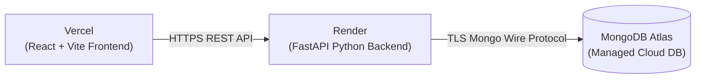

# Scholar AI — Complete Setup & Deployment Guide (Windows 11 & Production)

This guide provides step-by-step instructions for installing, configuring, running, and deploying **Scholar AI** on a local Windows 11 development machine and on cloud production platforms (Render and Vercel).

---

## 1. Prerequisites

Ensure the following tools are installed on your Windows 11 machine:

| Prerequisite | Minimum Version | Installation Check Command | Download Link |
| :--- | :--- | :--- | :--- |
| **Python** | 3.10+ (Recommended: 3.11–3.13) | `python --version` | [python.org](https://www.python.org/downloads/) |
| **Node.js** | 18.0+ (Recommended: 20+ LTS) | `node --version` | [nodejs.org](https://nodejs.org/) |
| **npm** | 9.0+ | `npm --version` | Included with Node.js |
| **Git** | 2.30+ | `git --version` | [git-scm.com](https://git-scm.com/) |
| **MongoDB Atlas Account** | Free M0 Tier | Web Console | [mongodb.com/cloud/atlas](https://www.mongodb.com/cloud/atlas) |
| **Serper.dev Account** | Free Tier (2,500 queries) | API Key Dashboard | [serper.dev](https://serper.dev/) |

> [!IMPORTANT]
> When installing Python on Windows, check the box **"Add Python to PATH"** in the installer window.

---

## 2. Windows 11 Local Development Setup

### Step 1: Clone the Repository
Open PowerShell or Command Prompt and run:
```powershell
git clone https://github.com/your-username/scholar-ai.git
cd "Scholar AI"
```

---

### Step 2: Configure the Backend Virtual Environment

1. Navigate to the backend directory:
   ```powershell
   cd backend
   ```
2. Create a Python virtual environment:
   ```powershell
   python -m venv .venv
   ```
3. Activate the virtual environment in PowerShell:
   ```powershell
   .venv\Scripts\Activate.ps1
   ```
   *(If you encounter a script execution policy error, run `Set-ExecutionPolicy -Scope Process -ExecutionPolicy Bypass` in your terminal session).*

4. Upgrade `pip` and install dependencies:
   ```powershell
   python -m pip install --upgrade pip
   pip install -r requirements.txt
   ```
   *(All required packages including `fastapi[standard]`, `pymongo`, `python-dotenv`, `python-jose`, `pwdlib[argon2]`, `bcrypt`, `certifi`, `requests`, `beautifulsoup4`, and `pytest` will be installed).*

---

### Step 3: Configure Backend Environment Variables

In the `backend/` directory, create a `.env` file:
```env
# MongoDB Atlas Connection
MONGODB_URI=mongodb+srv://<username>:<password>@cluster0.xxxxx.mongodb.net/?retryWrites=true&w=majority&appName=ScholarAI
MONGODB_DB=scholar_ai

# JWT Authentication Secret
JWT_SECRET_KEY=scholar-ai-super-secret-key-change-this-for-production-min32chars

# Google Serper Web Search API Key
SERPER_API_KEY=your_serper_dev_api_key_here

# Runtime Environment
ENVIRONMENT=development
```

> [!WARNING]
> **MongoDB Atlas IP Allowlist**:
> 1. Log in to your [MongoDB Atlas Dashboard](https://cloud.mongodb.com).
> 2. Navigate to **Security** $\to$ **Network Access**.
> 3. Click **Add IP Address** $\to$ Choose **Allow Access from Anywhere (`0.0.0.0/0`)** or click **Add Current IP Address**, then click **Confirm**.
> 4. Ensure your cluster is **Active** (not Paused).

---

### Step 4: Configure the Frontend

1. Open a new PowerShell terminal and navigate to the `frontend/` directory:
   ```powershell
   cd "d:\Scholar AI\frontend"
   ```
2. Install npm dependencies:
   ```powershell
   npm install
   ```
3. Create a `.env` file in the `frontend/` directory:
   ```env
   VITE_API_URL=http://127.0.0.1:8000
   ```

---

## 3. Running the Application Locally

### Running the Backend Server
In the activated backend terminal (`backend/.venv`):
```powershell
uvicorn app.main:app --reload --host 127.0.0.1 --port 8000
```
- **API Server**: Running at `http://127.0.0.1:8000`
- **Interactive Swagger Docs**: Available at `http://127.0.0.1:8000/docs`
- **Alternative ReDoc UI**: Available at `http://127.0.0.1:8000/redoc`

### Running the Frontend Server
In the frontend terminal:
```powershell
npm run dev
```
- **Vite Client**: Running at `http://localhost:5173`

Open your browser at `http://localhost:5173` to interact with Scholar AI.

---

## 4. Running Backend Tests

In your backend terminal:
```powershell
$env:PYTHONPATH="backend"
python -m pytest backend/tests -v
```
All 53 unit and integration tests across eligibility, authentication resilience, cache, dashboard deadlines, and saved scholarships will execute.

---

## 5. Cloud Production Deployment

Scholar AI is deployed across three services:



---

### Deploying the Backend on Render

1. Go to [Render.com](https://render.com) and create a new **Web Service**.
2. Connect your GitHub repository.
3. Configure the service settings:
   - **Root Directory**: `backend`
   - **Environment**: `Python`
   - **Build Command**: `pip install -r requirements.txt`
   - **Start Command**: `uvicorn app.main:app --host 0.0.0.0 --port $PORT`
4. Add Environment Variables in the Render dashboard:
   - `MONGODB_URI`: Your MongoDB Atlas connection string
   - `MONGODB_DB`: `scholar_ai`
   - `JWT_SECRET_KEY`: A cryptographically secure random 64-character secret
   - `SERPER_API_KEY`: Your production Serper API key
   - `ENVIRONMENT`: `production`
5. Note your deployed Render URL (e.g. `https://scholar-ai-backend.onrender.com`).

---

### Deploying the Frontend on Vercel

1. Go to [Vercel.com](https://vercel.com) and import your GitHub repository.
2. Configure project settings:
   - **Framework Preset**: `Vite`
   - **Root Directory**: `frontend`
   - **Build Command**: `npm run build`
   - **Output Directory**: `dist`
3. Add Environment Variable:
   - `VITE_API_URL`: Your deployed Render backend URL (e.g., `https://scholar-ai-backend.onrender.com`).
4. Click **Deploy**.

---

### CORS Whitelist in Backend

In [`backend/app/main.py`](file:///d:/Scholar AI/backend/app/main.py), ensure your Vercel production domain is listed under `allow_origins`:
```python
app.add_middleware(
    CORSMiddleware,
    allow_origins=[
        "http://localhost:5173",
        "http://127.0.0.1:5173",
        "https://scholar-ai-ebon.vercel.app",
        "https://your-custom-domain.vercel.app",
    ],
    allow_credentials=True,
    allow_methods=["*"],
    allow_headers=["*"],
)
```

---

## 6. Troubleshooting Common Errors

| Error | Root Cause | Solution |
| :--- | :--- | :--- |
| `Database service unavailable. Please check MongoDB Atlas connection.` | IP is not whitelisted in Atlas or cluster is paused. | Open MongoDB Atlas $\to$ Network Access $\to$ Add `0.0.0.0/0`. Check cluster status is active. |
| `SSL: CERTIFICATE_VERIFY_FAILED` | Windows Python TLS handshake missing trusted CA bundle. | Ensure `certifi.where()` is passed as `tlsCAFile` in `MongoClient` options. |
| `Cannot connect to backend server` | Frontend `.env` points to incorrect `VITE_API_URL` or backend is not running. | Verify `http://127.0.0.1:8000/health` is responsive in your browser. |
| `CORS Error in Browser Console` | Frontend domain not included in backend `allow_origins`. | Add the exact frontend origin URL in `backend/app/main.py` CORS middleware. |
| `401 Invalid or expired token` | JWT expired (7 days) or secret key was changed. | Log out and log back in to refresh token in `localStorage`. |
